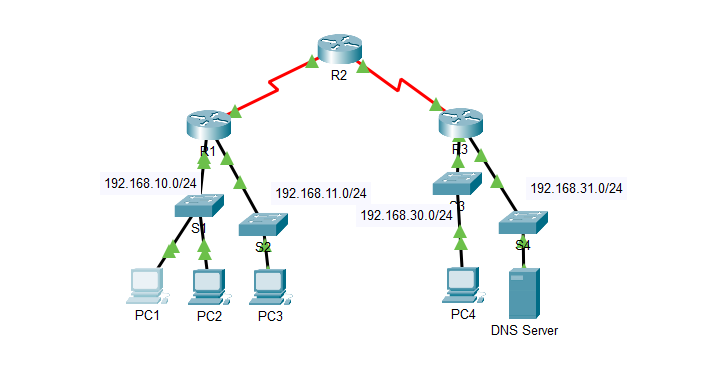

# Proyecto 02 — Análisis de una ACL estándar en Cisco Packet Tracer

## Descripción

Práctica realizada durante mi formación en redes y ciberseguridad. El objetivo fue observar cómo una **lista de control de acceso (ACL)** puede impedir la comunicación entre redes, investigar su configuración en un router Cisco y comprobar qué sucede al retirarla.

> Este laboratorio parte de una topología y una ACL ya configuradas. No he creado la ACL desde cero: la he analizado, retirado y comprobado su efecto.

## Herramientas y conceptos

- Cisco Packet Tracer
- CLI de Cisco IOS
- Direccionamiento IPv4, ICMP (`ping`), ACL estándar y dirección de filtrado `out`

## 1. Topología



La topología contiene tres routers (R1, R2 y R3), cuatro switches (S1–S4), cuatro equipos (PC1–PC4) y un servidor DNS. Las redes LAN visibles son:

| Red | Dispositivos relevantes |
| --- | --- |
| `192.168.10.0/24` | PC1 y PC2 |
| `192.168.11.0/24` | PC3 |
| `192.168.30.0/24` | PC4 |
| `192.168.31.0/24` | Servidor DNS |

## 2. Verificación de conectividad inicial

Desde la consola de **PC1** ejecuté pruebas `ping` hacia dispositivos locales y remotos.

| Destino | Dirección IP | Resultado inicial |
| --- | --- | --- |
| PC2 | `192.168.10.11` | 4/4 respuestas, 0 % de pérdida |
| PC3 | `192.168.11.10` | 3/4 respuestas, 25 % de pérdida |
| PC4 | `192.168.30.12` | 0/4 respuestas, 100 % de pérdida |
| Servidor DNS | `192.168.31.12` | 0/4 respuestas, 100 % de pérdida |

### Pruebas a PC2 y PC3


### Pruebas a redes remotas

Los intentos hacia PC4 y el servidor DNS devolvieron `Destination host unreachable` desde `192.168.10.1` (R1).


## 3. Investigación de la ACL

En la CLI de R1 consulté la lista existente:

```text
R1# show access-lists
Standard IP access list 11
    10 deny 192.168.10.0 0.0.0.255 (8 match(es))
    20 permit any
```


La primera regla **deniega** el tráfico cuyo origen sea la red `192.168.10.0/24`. La segunda **permite** tráfico de otros orígenes. La máscara `0.0.0.255` es una *wildcard mask* que identifica los 24 bits de red que deben coincidir.

Después, con `show run`, comprobé dónde estaba aplicada:

```text
interface Serial0/0/0
 ip address 10.10.1.1 255.255.255.252
 ip access-group 11 out
```


La ACL estaba asociada a **Serial0/0/0 de R1**, en dirección **saliente (`out`)**. Por eso bloqueaba el tráfico originado en `192.168.10.0/24` que necesitaba atravesar esa interfaz para alcanzar las redes remotas. La comunicación local o hacia la red conectada a otra interfaz no seguía ese mismo recorrido.

## 4. Retirada de la ACL

Siguiendo las instrucciones del laboratorio, primero desvinculé la ACL de la interfaz y después eliminé su definición:

```text
R1# configure terminal
R1(config)# interface serial0/0/0
R1(config-if)# no ip access-group 11 out
R1(config-if)# exit
R1(config)# no access-list 11
R1(config)# end
R1# show access-lists
```

La última consulta no mostró ninguna ACL configurada.


## 5. Verificación después del cambio

Repetí los pings desde PC1:

| Destino | Antes | Después |
| --- | --- | --- |
| PC4 (`192.168.30.12`) | 0/4 respuestas | 3/4 respuestas |
| Servidor DNS (`192.168.31.12`) | 0/4 respuestas | 3/4 respuestas |


En ambas pruebas el primer paquete agotó el tiempo de espera y los tres siguientes respondieron. Esto confirma que la conectividad con los dos destinos se recuperó. En Packet Tracer, una primera pérdida puede estar relacionada con la resolución ARP u otros procesos iniciales, aunque estas capturas por sí solas no permiten determinar la causa exacta.

## 6. Qué he aprendido

- Una ACL estándar filtra paquetes según su **dirección IP de origen**.
- Las reglas se evalúan en orden; `deny` bloquea y `permit` permite el tráfico que coincida.
- Para que una ACL actúe sobre el tráfico debe estar aplicada a una interfaz y dirección determinadas.
- `show access-lists` permite revisar las reglas y sus coincidencias; `show run` ayuda a localizar dónde se aplican.
- Es importante distinguir entre **quitar una ACL de una interfaz** (`no ip access-group 11 out`) y **borrar su definición** (`no access-list 11`).
- Las pruebas `ping` antes y después de un cambio permiten comprobar su efecto sobre la conectividad.

**Conclusión:** la ACL 11 estaba cumpliendo su función de impedir la salida del tráfico originado en `192.168.10.0/24` por la interfaz Serial0/0/0. Al retirarla, PC1 volvió a alcanzar PC4 y el servidor DNS. En una red real, no eliminaría una ACL sin revisar antes la política de seguridad y el motivo de sus reglas.

---

*Práctica educativa realizada con Cisco Packet Tracer como parte de mi formación en redes y ciberseguridad.*
